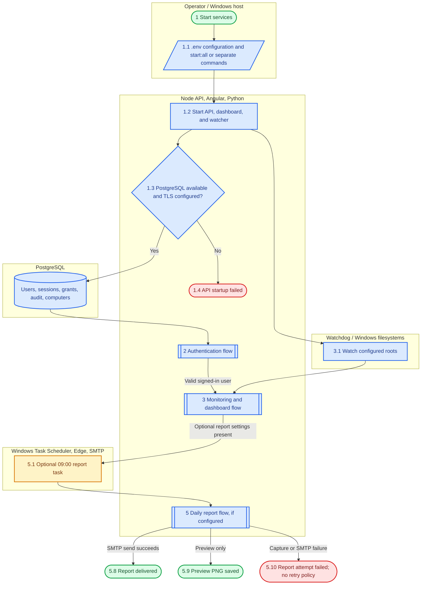
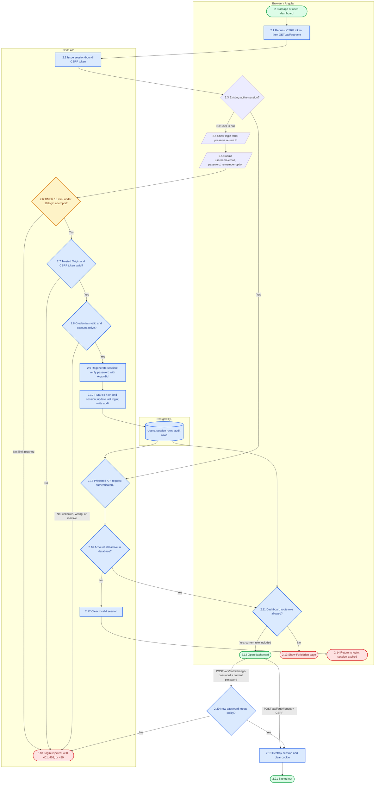
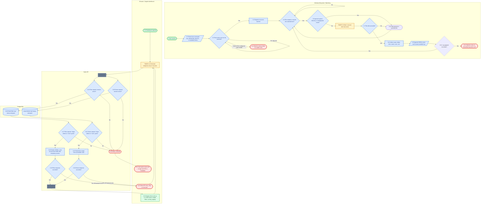
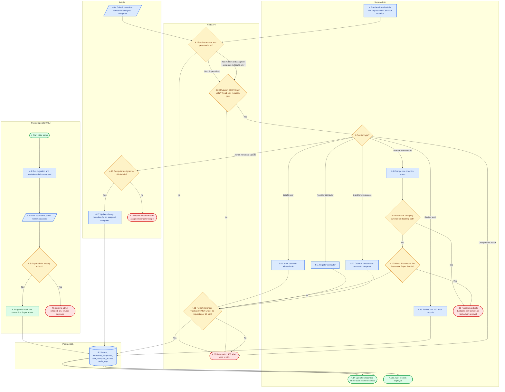
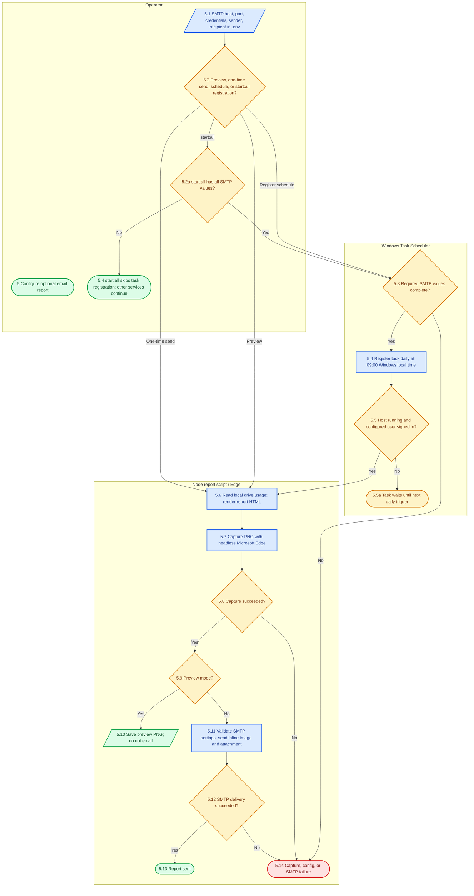

# System Storage Monitor — workflow map

This draft is based on the current Angular routes/services, Express API, PostgreSQL schema, Python watcher, and Windows report scripts. The companion [workflow-overview.html](workflow-overview.html) is a standalone, zoomable SVG overview.

## What the system does

The **System Storage Monitor** watches configured local folders for newly created or moved files, records file metadata in a JSON Lines log, and lets authenticated users view those events and current drive capacity in an Angular dashboard. PostgreSQL stores accounts, roles, computer grants, sessions, and audit records. A separate optional Windows Task Scheduler job captures and emails a daily drive-capacity screenshot.

### Actors and systems found in code

- **Super Admin** — manages user accounts, roles, activation, monitored-computer records, access grants, and audit review.
- **Admin** — can update metadata for assigned computers; can view dashboard data when granted access.
- **IT Engineer** and **Viewer** — dashboard read access when granted access to computer `local`.
- **Browser / Angular app** — restores session state, guards the dashboard route, and refreshes data every five seconds.
- **Node API** — checks session, active-account status, role, computer access, CSRF/origin rules, and rate limits.
- **PostgreSQL** — identity, server-side sessions, grants, computer metadata, and audit log.
- **Python Watchdog / Windows filesystem** — detects create/move events, filters temporary/system paths, waits for file settling, then appends JSONL and human-readable logs.
- **Windows Task Scheduler / Microsoft Edge / SMTP** — optional daily report workflow. SMTP is used for the report only; there are no event-triggered alert emails.

### Variants represented

1. Session restore versus interactive login; remembered session versus normal session.
2. Dashboard access: Super Admin bypasses the `local` grant check; all other roles need that grant.
3. Watcher event: accepted file versus ignored path/temp file, vanished file, inaccessible root, or watcher failure.
4. Report: preview-only, one-time send, or scheduled send; SMTP setup is optional.
5. Startup: one-command `start:all` or separate processes.

There are no approval tiers, escalation timers, cancellation/reopen states, or operational SLA timers in the code. The one-second file-settle delay, five-second dashboard poll, authentication rate windows, session expiry, and 9:00 AM task are implementation timers, not approval SLAs.

## Legend

- Green = successful/end state; red = rejected or failed; amber = waiting/timer; blue = automatic/system action.
- Rounded nodes = start/end; rectangles = actions; diamonds = decisions; parallelograms = input/output/notification; `TIMER` labels mark elapsed-time behavior.
- `Yes`/`No`, role, and event labels identify decision exits. Parallel bars show concurrent work.

## 1. End-to-end overview

## 2. Authentication, route access, and session lifecycle

Notes: `/api/auth/me` returns `{user:null}` when no session is present. A stale session whose account was deleted or deactivated gets 401 and is destroyed. Login failure uses a generic 401 for an unknown user, wrong password, or inactive account. The API rate-limits login to 10 requests per 15 minutes. Successful login regenerates the session and rotates the CSRF token. `remember=true` sets 30 days; otherwise 8 hours. Cookies are HttpOnly and SameSite Strict; Secure is enabled in production. Password changes require the current password and a 12-128 character password with upper, lower, and numeric characters, are limited to 5 attempts per 15 minutes, invalidate existing sessions, and clear the browser cookie.

## 3. File monitoring and dashboard refresh

The two dashboard requests (`/api/files` and `/api/drives`) are issued concurrently. A non-Super Admin needs an explicit grant to computer ID `local`; a grant to another computer does not satisfy the current dashboard check. The UI retries at the next five-second poll after a request failure. The file log reader scans only the newest 8 MiB and returns up to 1,000 valid events, so the dashboard is a recent-event view rather than a complete archive. File logs remain on disk; PostgreSQL does not store these event rows. The API response timeout is 15 seconds and returns HTTP 408; no request cancellation or retry backoff is configured.

## 4. User, role, computer, and access administration

Every admin endpoint is limited to 30 requests per 15 minutes. User creation, account/role changes, computer registration, metadata changes, and grant/revoke operations attempt to write audit rows. Audit insert errors are logged by the API but do not roll back the operation. Only Super Admin can manage users, registrations, grants, and audit review. Admin can update metadata only when assigned. IT Engineer and Viewer have no admin mutation endpoints. All roles currently have dashboard navigation access; computer grants still gate API data.

## 5. Daily drive screenshot report

The daily task is scheduled at 09:00 in Windows local time and runs only while its configured Windows account is signed in (`/IT`). `REPORT_TIMEZONE` controls report date/time formatting; it does not set the Task Scheduler trigger timezone. `start:all` registers/refreshes the task only if all required SMTP values are populated; the task itself runs separately. Preview produces a PNG and skips email. Scheduled and one-time sends create the screenshot, then send through SMTP. The send work directory is removed afterward. No automatic retry/escalation policy is configured for Edge or SMTP failure; the scheduled task will next run at its next daily trigger.

## Step table

| Step No. | Actor/Role | Action | Decision/Condition | Next step (Yes/No) | Time limit | Notification sent |
|---|---|---|---|---|---|---|
| 1 | Operator | Configure `.env`; run `start:all` or start services separately | PostgreSQL reachable with TLS? | Yes 1.2; No 1.4 | Startup; no automatic retry | Console startup/error |
| 1.2 | Runtime | Start API, Angular, watcher; optionally register report task | SMTP keys complete? | Yes register task; No skip registration | Startup | Console status |
| 2.1 | Angular | Request CSRF token, then `/api/auth/me` | Existing session? | Yes check session; No show login | App load | None |
| 2.2 | API | Create/reuse session-bound CSRF token | Session store available? | Yes return token; failure is API error | Per request | None |
| 2.3 | Browser/API | Restore current user | Active session returned? | Yes 2.11; No 2.4 | App load | None |
| 2.4 | Angular | Show login and preserve requested return URL | Valid form submitted? | Yes 2.5 | None | Inline message on failure |
| 2.5 | User | Submit username/email, password, remember option | Form values valid? | Yes 2.6 | None | None |
| 2.6 | API | Apply login rate limit | Under 10 attempts in window? | Yes 2.7; No 429 | 15 minutes | Generic inline sign-in message |
| 2.7 | API | Validate Origin and CSRF token | Both trusted and matching? | Yes 2.8; No 403 | Per request | Generic inline sign-in message |
| 2.8 | API/DB | Normalize identifier; verify Argon2id and active status | Credentials valid and active? | Yes 2.9; No generic 401 | Per request | Generic sign-in message; failed-login audit attempt |
| 2.9 | API | Regenerate session and rotate CSRF token | Session creation succeeds? | Yes 2.10; No API error | Per request | Browser receives user/token |
| 2.10 | API/DB | Store login time and session expiry | Remember selected? | 30 days; otherwise 8 hours, rolling | 30 days / 8 hours | None |
| 2.11 | Angular | Apply auth and role guards | Role is on dashboard allowlist? | Yes dashboard; No 2.13 | Navigation | Forbidden page or login redirect |
| 2.19 | API | Process logout after auth and CSRF checks | Session destroy succeeds? | Yes 2.21; No API error | Per request | 204 response |
| 2.13 | Browser | Show Forbidden page | User returns to dashboard | Guard checks access again | Until role/access changes | None |
| 2.14 | Browser | Return to login after expired/revoked session | User signs in again? | Yes 2.5 | 8 h / 30 d rolling session | Session-expired message |
| 2.15-2.17 | API/DB | Check protected request session and account status; destroy invalid session | Session exists and user active? | Yes continue; No 401 and login redirect | Every protected request | None |
| 2.18 | API | Reject invalid request/login | Validation, auth, CSRF, or limiter failure? | User corrects input, signs in, or retries later | Login limit: 10 / 15 min | Inline sign-in message |
| 2.20 | API | Change password after verifying current password | New password meets policy? | Yes update and revoke sessions; No reject | 5 attempts / 15 min | Inline error or 204 |
| 2.21 | Browser/API | Complete signed-out state | Session destroyed? | Yes end signed out; API failure surfaced | Per request | 204 response |
| 3.1-3.3 | Watchdog | Resolve roots and register recursive handlers | Each root available/watchable? | Watch usable roots; skip unavailable; none usable fails startup | Startup | Console message |
| 3.4-3.5 | Watchdog | Detect created/moved file and filter directories/temp/system paths | Is it an ignored path? | Yes skip; No 3.6 | Event driven | None |
| 3.6-3.9.2 | Watchdog | Wait for settling, collect metadata, append logs | File accessible and log append succeeds? | Yes keep watching; inaccessible file skips; write failure exits watcher | 1 second settle; write is immediate | Console error if watcher exits |
| 3.10-3.11 | Watchdog | Skip ignored/vanished files; fail if no roots can be watched | Any handlers registered? | Yes keep watching; No runner stops services | Startup/event time | Console output |
| 3.12-3.14 | Angular | Open dashboard; fork parallel `/api/files` and `/api/drives` requests | Both requests authorized? | Yes fetch in parallel; No API denial path | Poll every 5 seconds | None |
| 3.15-3.17, 3.20-3.21 | API/DB | Independently check each request's session, active account, and `local` grant | Super Admin or grant exists? | Yes continue; No 401/403 | 15-second API response timeout | None |
| 3.18-3.19 | API | Stream recent JSONL events and check response | Response succeeds? | Yes join; No show error and retry | Per poll request | None |
| 3.22-3.27 | API/Angular | Read drives, check response, join data, render or route on failure | Both responses succeed? | Yes refresh; No retry or route to login/Forbidden | Every 5 seconds | Dashboard error banner; no email |
| 4.1-4.5 | Operator/CLI | Migrate schema and provision first Super Admin | Super Admin already exists? | No create; Yes CLI refuses duplicate | One-time | CLI output |
| 4.6-4.12 | Super Admin | Create/update users, register computers, manage grants | Role, CSRF, input, and last-admin rules pass? | Yes apply; No reject 400/403/404/409/429 | 30 admin requests / 15 min | API response; audit attempt |
| 4.13 | Super Admin | Read the most recent 200 audit entries | Authorized Super Admin? | Yes return rows; No 401/403 | 30 admin requests / 15 min | API response; read is not itself audit-logged |
| 4.14-4.15 | API | Complete mutation/audit attempt or reject invalid operation | Database update and validation succeed? | Yes return result; No reject; audit failure is logged | Per request | API response / server log |
| 4.16-4.18 | Admin | Update metadata for assigned computer | User has assignment? | Yes update; No 404 | 30 admin requests / 15 min | API response; audit attempt |
| 4.19-4.23 | API/DB | Authorize admin request, validate CSRF/input/rate limit, write data | Request is permitted and valid? | Yes apply; No 401/403/400/404/409/429 | 30 admin requests / 15 min | API response; audit attempt |
| 5.1-5.3 | Operator | Configure SMTP; choose preview, send, or schedule | Required settings complete for selected action? | Yes continue; No registration/send error or start:all skips task | On command | Console output |
| 5.4-5.5a | Windows Task Scheduler | Register task and trigger at 09:00 | Host running and configured account signed in? | Yes run; No wait for next daily trigger | Daily 09:00 Windows local time | Task Scheduler history |
| 5.6-5.8 | Report script/Edge | Read drives, render HTML, capture PNG | Edge found and capture succeeds? | Yes 5.9; No 5.14 | Edge timeout 45 seconds | Console/task error |
| 5.9-5.10 | Report script | Check preview mode and save preview PNG | Preview requested? | Yes save PNG/end; No 5.11 | Per command | Console path to PNG |
| 5.11-5.14 | SMTP/report script | Validate SMTP and send inline image/attachment | SMTP delivery succeeds? | Yes sent; No failure; no automatic retry | SMTP connection/greeting/socket timeouts | Email on success; task history on failure |

## Edge cases and assumptions

- The user-provided project fields were placeholders. Project name and purpose above are inferred from code and README.
- `start:all` is a convenience runner: API, Angular, and Python watcher are child processes. A required child failure stops the other services. The optional daily email task is a separate Windows Task Scheduler job.
- By default, the Python watcher watches all existing drive roots; command-line roots override that. `MONITOR_ROOTS` is semicolon-separated for `start:all`.
- Only the `local` monitored-computer grant is checked by the current dashboard data endpoints. The API has broader computer registration/grant-management primitives, but the UI has no admin pages in the inspected route/component set.
- All four roles are listed as allowed for the `/dashboard` UI route. API authorization still checks current account activation and a grant for non-Super Admin users.
- The API reads JSONL logs from disk; database schema has no file-event table. The event endpoint intentionally truncates to a recent window and cap.
- The human-readable watcher log rotates, but the JSONL event log is append-only and has no retention/rotation limit. The API bounds each read but does not bound disk growth. The watcher records create/move events, not file modifications or deletions.
- Failed login produces the same generic response for an unknown account, incorrect password, or inactive account. An unauthenticated session lookup currently returns `{user:null}`; a stale/deactivated session returns 401.
- Session expiration is eight hours by default or 30 days when Keep me signed in is selected. Session middleware rolls cookie expiration on requests.
- Login and admin rate limits use the default in-memory limiter store. No shared store or distributed limiter is configured.
- Audit writes are attempted after administrative changes and errors are logged. The write and corresponding change are not consistently in one transaction, so audit completeness is not guaranteed during database failure.
- The task scheduler uses the Windows host local clock for 09:00. `REPORT_TIMEZONE` affects the rendered report timestamp, not scheduling; the script does not force Asia/Kolkata task time.
- No event email, drive-capacity threshold alert, approval workflow, escalation, manual reopen/cancel, or retry policy was found. The report is a periodic snapshot, not an alert system. If no drives are available, the report renders an empty-state message rather than failing.
- API health check exists at `/api/health`; startup checks DB connectivity once and exits with failure rather than retrying indefinitely.

## Differences between requested description and implementation

- Requested role-specific approvals/escalations, time limits, and rejection/rework/cancel states have no corresponding process in the code. They are not drawn as if implemented.
- “Notifications” are limited to login/API UI responses, console logs, scheduled-task output/history, and the optional daily SMTP report. There are no file-event notifications or threshold alerts.
- The report uses Windows Task Scheduler, Microsoft Edge headless capture, and SMTP; it does not use a payment gateway, WebSocket, external drive API, or cloud screenshot service.
- Admin APIs exist, but no admin-management UI route was found in the Angular routes/components inspected.
- Report schedule time follows Windows local time, while the report’s displayed timestamp/date uses `REPORT_TIMEZONE` (default Asia/Kolkata). These settings may diverge on a host in another timezone.

## Open questions

1. Should drive-capacity thresholds (for example 80% and 90%) generate immediate alert emails, or is the daily snapshot sufficient?
2. Should daily scheduling be fixed to Asia/Kolkata regardless of the Windows host timezone?
3. Should IT Engineer and Viewer receive the same file-event details, or should access be scoped by folder/drive?
4. Should Admin users be allowed to create or deactivate accounts, or remain limited to assigned-computer metadata updates?
5. Do you want an approval step for granting access or changing roles? If so, who approves and what is the escalation timeout?
6. Should the dashboard offer older events beyond the most recent 1,000 entries / 8 MiB log scan?
7. What retention or rotation period should apply to the append-only JSONL event log?
8. Should SMTP/Edge failures retry automatically, and how many times before alerting an administrator?
9. Should the system support a remote monitored computer, beyond the current local-host collector?

